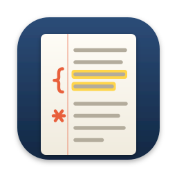

<p align="center">
  
</p>

<h1 align="center">marginalia</h1>

<p align="center">
  A native macOS notebook for typed notes and PDF annotation — built with SwiftUI, AppKit and PDFKit.<br>
</p>

<p align="center">
  <a href="LICENSE"></a>
  
  
  
</p>

marginalia is a notebook app for people who take notes with a keyboard. You write on
pages, import lecture slides and papers as PDFs, and mark them up with highlights,
freehand strokes and sticky notes. Typed text flows from page to page like in a word
processor. Export gives you a flat PDF that looks the same everywhere.

There are no accounts and no cloud. Your library lives on your Mac and is saved
automatically. Every notebook is a self-contained package that you can inspect in Finder.

## Highlights

- **Write across pages.** One continuous text flows over all blank pages. If it runs
  past the last page, a new one is added. You get bold, italic, underline, font sizes,
  paragraph alignment, and lined or grid paper.
- **Annotate any PDF.** Highlight text, draw freehand, place sticky notes and erase,
  each with full undo. Annotations are real PDF annotations, so other readers can see
  them too.
- **One kind of document.** An imported PDF behaves like any other notebook: you can
  annotate it, add blank pages, write on them and export it.
- **Images on the page.** Insert images through the file dialog or by drag & drop, then
  move and resize them on the page. The original file is kept untouched.
- **Clean PDF export.** Text, guide lines and images are burned into the pages. The
  text stays real text, so searching and copying keep working.
- **Library with tabs.** Folders and notebooks in a sidebar, several documents open in
  tabs, and a home screen with recently opened documents.
- **Never lose work.** Autosave three seconds after the last change, and again when you
  close a tab, switch apps or quit. If saving fails, the document stays open.

## Requirements

- macOS 15 or later
- To build: Xcode 16 or later

## Build from source

```bash
git clone https://github.com/schneider-leon/marginalia.git
open marginalia/marginalia/marginalia.xcodeproj
```

In Xcode, select your own team under *Signing & Capabilities* (or "Sign to Run Locally").
Then run the **marginalia** scheme (⌘R). The built app is called `marginalia.app`.

The app runs in the App Sandbox. The library lives in the app's container under
`~/Library/Containers/app.marginalia.macos/Data/Documents/Library`.

To build and test from the command line:

```bash
xcodebuild -project marginalia/marginalia.xcodeproj -scheme marginalia -destination 'platform=macOS' build
xcodebuild test -project marginalia/marginalia.xcodeproj -scheme marginalia -destination 'platform=macOS'
```

## Quick start

1. Start marginalia. Click **+** in the sidebar to create a folder or a notebook, or press
   `⌘O` to import a PDF.
2. In **Write** mode, type on the page. Use the strip below the tab bar for formatting,
   paper style and inserting pages or images.
3. Switch to **Annotate** mode to highlight, draw or add sticky notes. Your typed text
   stays visible and can be highlighted too.
4. Press `⇧⌘E` to export the notebook as a PDF.

| Shortcut      | Action                     | Shortcut      | Action                 |
| ------------- | -------------------------- | ------------- | ---------------------- |
| `⌘O`          | Import PDF                 | `⌘1`–`⌘9`     | Switch to tab          |
| `⌘S`          | Save                       | `⇧⌘[` / `⇧⌘]` | Previous / next tab    |
| `⇧⌘E`         | Export as PDF              | `⌘W`          | Close tab              |
| `⌘Z` / `⇧⌘Z`  | Undo / redo                | `⌘+` / `⌘-`   | Zoom in / out          |
| `⌃1`–`⌃5`     | Select, highlight, freehand, note, eraser | `⌘0` | Fit to window width |
| `⌃⌘S`         | Show / hide library        | `⌥⌘↑` / `⌥⌘↓` | Previous / next page   |

## The notebook format

Every document in the library is a `.marginalia` package: a folder that Finder shows as
a single file.

```
Lecture.marginalia/
  info.json       schema version, title, page order and page kinds
  content.pdf     the pages: imported and blank, plus their PDF annotations
  body.rtf        the continuous typed text
  overlays.json   image placements per page
  assets/         inserted images, byte for byte
```

- **`content.pdf` is the truth about pages and geometry. `body.rtf` and `overlays.json`
  hold everything that stays editable.** Typed text is not stored as FreeText
  annotations. That would rule out reflow, and any external PDF reader could edit it.
- Packages are named after the notebook's ID, not its title. Renaming never moves a
  file, and two notebooks may share a name.
- Both JSON files use hand-written, readable encodings with a `type` discriminator and
  named frame fields. Newer schema versions are rejected instead of being overwritten.
  Small inconsistencies, such as missing page descriptions, are repaired when the
  notebook opens.
- Writes go to a staging folder first, then replace the package. An unchanged
  `content.pdf` is hard-linked instead of rewritten.

## Architecture

```
marginalia/
  marginalia/
    App/            MarginaliaApp (scene, SwiftData container), RootView, menu commands
    Models/         LibraryEntry (SwiftData index), LibraryNode, NotebookInfo,
                    NotebookOverlay, AnnotationTool
    Features/
      Library/      LibraryStore (facade over SwiftData), sidebar, home screen
      Tabs/         TabsStore, tab bar
      Viewer/       DocumentSession (state of one open document), PDF view chrome,
                    toolbars
      Editor/       writing mode: text engine, page views, image overlays
    PDFKitBridge/   NSViewRepresentable, PDFView subclass for the annotation tools,
                    sticky note editor
    Services/       NotebookPackage (read/write), renderer, importer, export,
                    thumbnails
    Support/        UTType, focused values, shared appearance
  marginaliaTests/  unit tests; fixtures are generated with CoreText at runtime
  Design/           app icon source (SVG) and export script
```

| Concern                   | Approach                                                                  |
| ------------------------- | ------------------------------------------------------------------------- |
| Text across pages         | One `NSTextStorage` over many page-sized `NSTextContainer`s (TextKit 1)   |
| Highlights, ink, notes    | Real `PDFAnnotation`s in `content.pdf`                                    |
| Typed text and images     | Kept separate while editing, burned into the pages on export              |
| SwiftUI ↔ PDFKit          | Thin `NSViewRepresentable`; imperative commands through a coordinator     |
| Library                   | SwiftData as an index only; documents are files found by ID               |
| Imported PDFs             | Copied into the library, never linked; the original is never touched      |
| Both modes                | One window toolbar, one zoom value and one current page shared by both    |

SwiftData stores only the library structure (names, folders, order, timestamps). A
broken or migrated database never costs notes, because the content lives in the
packages next to it.

## Use of AI

marginalia was developed with the help of AI coding assistants, including Claude Code.

## License

[MIT](LICENSE)
